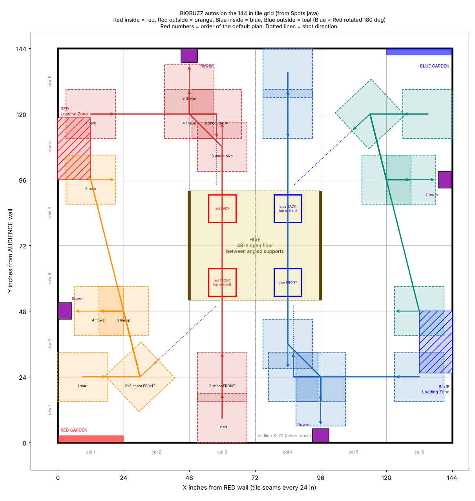

# Warbots 10415 - BIOBUZZ (2026-2027)

Robot code for FTC team 10415, Warbots, for the 2026-2027 game BIOBUZZ.
Built on FTC SDK 12.0, Pedro Pathing 3, and a goBILDA Pinpoint odometry computer.

The whole robot program is about 1,100 lines of Java in 14 files. We kept it small on purpose,
so anyone on the team can find and fix a problem in the pit between matches.

## Our robots

We work with two robots that run the same code.

| Robot | Hardware | What it is for |
|---|---|---|
| **Drive base** | 4 mecanum wheels, goBILDA Pinpoint with two odometry pods | Drive practice, path tuning, auto testing |
| **Competition robot** | Drive base + intake motor, transfer motor, flywheel (outtake) motor, shooter-angle servo | Matches |

How a pollen moves through the competition robot:

1. **Intake** pulls pollen off the floor or out of the bottom of a flower.
2. **Transfer** carries it up to the shooter, but only once the flywheel is at speed.
3. **Flywheel** launches it. We control the flywheel by speed (rpm), not by power, so shots
   stay the same as the battery drains.
4. **Angle servo** sets how high the shot goes.

If a part is missing from the robot configuration, the code skips it and lists it on the
Driver Station screen instead of crashing. That lets us run every OpMode on the drive base alone.

## OpModes

| OpMode | Type | When we use it |
|---|---|---|
| **1 Drive - no odometry** | TeleOp | Backup if the Pinpoint fails. Plain robot-centric driving. |
| **2 Drive - odometry** | TeleOp | Field-centric driving, with buttons that drive to our shooting spots. |
| **3 Full robot** | TeleOp | Our match TeleOp: OpMode 2 plus all mechanisms on gamepad 2. |
| **Inside - straight** | Auto | Match auto through the middle of the hive, shooting straight on. |
| **Outside - angled** | Auto | Match auto along the alliance wall, shooting at 45 degrees. |
| **Practice - leave and park** | Auto | Scores LEAVE and PARK only. Needs no mechanisms. |
| **Motor Check** | TeleOp | Tests one motor or servo at a time, with the robot on a block. |

The three TeleOps build on each other: 1 has no odometry, 2 adds odometry, 3 adds the mechanisms.
After an auto, TeleOp 2 and 3 keep the robot's position and alliance, so field-centric driving
is correct from the first second.

### Driver controls

**Gamepad 1 (driver)**

| Control | Action |
|---|---|
| Left stick | Drive (field-centric in TeleOp 2 and 3) |
| Right stick X | Turn |
| Left bumper | Slow mode (40% power) |
| Y | Reset heading. Point the robot away from your alliance wall first. |
| Hold A | Drive to the inside shot on whichever side of the hive the robot is on |
| Hold B | Drive to the outside shot |

**Gamepad 2 (operator, TeleOp 3)**

| Control | Action |
|---|---|
| A / Y / B | Load the inside-front, inside-back, or outside shot (sets angle and flywheel speed) |
| Right bumper | Fire. Feeds only when the flywheel is at speed. The gamepad rumbles when it is ready. |
| Right trigger / left trigger | Intake in / out |
| D-pad up / down | Raise / lower the shot angle |
| D-pad right / left | Raise / lower the flywheel speed |
| X | Stop all mechanisms |

The controls are also written at the top of each OpMode file.

## Autonomous strategy



The map above is drawn to scale from the positions in our code.

### The rules we designed around

- The hive cells open toward the audience side (front) and the scoring side (back). We only shoot
  from those two sides, into whichever cell is tipped up. On Red the front cell starts up,
  and on Blue the back cell starts up.
- We never cross the middle of the field and never touch the hive's metal frame.
- The two autos use separate lanes, so they never cross or touch. That means we can run either
  one next to an alliance partner.

### Field grid

Every position is on the 144 inch field grid: 6 x 6 tiles, 24 inches each, counted from the
corner where the Red wall meets the audience wall. To place the robot, count tiles. For example,
the inside start is "back bumper on the audience wall, centered in tile column 3" (X = 60).

### The plan list

Each match auto starts with an editable list of jobs, run in order, then it parks:

```java
// AutoInside.java
static final Job[] PLAN = { FRONT, FLOWER, BACK };
```

- `FRONT`: shoot the audience-side cell (Red's starts up)
- `BACK`: shoot the scoring-side cell (Blue's starts up)
- `FLOWER`: refill at our flower (the robot holds 4)

The robot starts with 4 preloaded pollen, so the default fires them into the front cell first,
then refills and fires into the back cell. Reorder or remove jobs to change the strategy.

### Inside - straight (tile column 3)

The robot drives up the middle of our half of the hive. There are 48 inches of floor between
the hive's angled supports (on the X = 48 and X = 96 seams), so we use the center of our 24 inch
half, X = 60. That leaves 3 inches of clearance from the support and from the midline.
Whenever the next job is on the other side of the hive, it drives straight down this lane.
It never turns under the hive.

Default plan `{ FRONT, FLOWER, BACK }`:

1. Start: back bumper on the audience wall, centered in column 3 (60, 9).
2. Drive forward one tile and shoot the 4 preloads straight into the front cell (60, 24).
3. Drive under the hive to (60, 108), then collect from the scoring-wall flower (48, 129).
4. Turn around at (58, 120) and shoot straight into the back cell.
5. Park in the top of the loading zone (12, 120).

The robot has to fit under a lowered cell, which is about 30.6 inches.

### Outside - angled (tile columns 1-2)

The robot stays between the alliance wall and the hive support. Allowed jobs are `FRONT` and
`FLOWER`. `BACK` would cross the inside lane, so it is not allowed here.

Default plan `{ FRONT, FLOWER, FRONT }`:

1. Start: back bumper on the Red wall, centered on the 1-tile seam (9, 24).
2. Shoot the 4 preloads into the front cell at an angle (30, 24, 43 degrees).
3. Collect from the Red-wall flower, 2 tiles up (15, 48).
4. Shoot again from the same spot.
5. Park in the bottom of the loading zone (12, 96).

### Safety built into every auto

- **Park guard.** At 24 seconds the robot stops what it is doing and drives to park, so we
  never lose the PARK points by running out of time.
- **Timeouts.** If a drive step takes longer than 5 seconds (for example, the robot got bumped),
  the robot skips the rest of the route and parks.
- **Start delay.** During INIT, D-pad up/down adds a start delay, so we can stay out of our
  partner's way.
- **Alliance select.** During INIT, press X to choose Red or Blue. The screen shows every
  choice before the match starts.

### One set of numbers for both alliances

Every field position is written once, in Red coordinates, in `Spots.java`. The field is
symmetric about its center, so the Blue position is the same spot rotated 180 degrees
(`Spots.forAlliance`). When we fix a spot for Red, Blue gets the fix too.

### Not fully automatic, not hand-written paths

Each auto is a short plan list, and each job uses positions from `Spots.java`. The code works out
the line between positions, so we never hand-code a path. But every position is a real number on
the tile grid that we can measure on the field and change in one place.

## Code layout

| File | What is in it |
|---|---|
| `Settings.java` | Every hardware name, motor direction, power, limit and timing, in one place |
| `Spots.java` | Every field position and every shot (position, flywheel rpm, angle) |
| `AutoInside.java`, `AutoOutside.java`, `AutoPractice.java` | Each auto's list of steps |
| `AutoBase.java` | What the steps do: drive, shoot, collect, wait, park, and the safety rules |
| `TeleOp1Drive.java`, `TeleOp2Odometry.java`, `TeleOp3Full.java` | The three TeleOps |
| `Drive.java` | Mecanum wheel math for driving without odometry |
| `Mechanisms.java` | Intake, transfer, flywheel and angle servo |
| `Find.java` | Finds hardware by name and returns nothing instead of crashing if it is missing |
| `MotorCheck.java` | One-motor-at-a-time test |
| `pedro/Constants.java` | Path-following tuning values from Pedro AutoTune |

When something goes wrong at a competition, there are usually only two places to look:
a number in `Settings.java` or a position in `Spots.java`.

## Tuning

### Path following

We tune with Pedro Pathing's AutoTune. With the robot on, open `http://<Robot Controller IP>:10158`
and run Mecanum, Pinpoint, Foresight, then Tests. Then paste the results into `pedro/Constants.java`.
The values in the code now come from the drive base. We will tune again on the competition robot.

### Shots

1. Run **3 Full robot** and load a shot on gamepad 2 (A, Y or B).
2. Change the angle (D-pad up/down) and flywheel speed (D-pad left/right) until it scores every time.
3. Copy the rpm and angle shown on the screen into that shot in `Spots.java`.

The autos and TeleOp use the same shot values, so a shot tuned in practice also works in auto.

The angle servo has not been tested on the robot yet. `Settings.ANGLE_LOWEST` and `ANGLE_HIGHEST`
keep it between 0.30 and 0.70 until we measure its real limits with **Motor Check**.

## Testing and debugging

The Driver Station screen always shows:

- the current step (for example "BACK FLOWER") and why the auto skipped ahead, if it did
- the robot's position and the target position
- flywheel speed compared to its target, and the angle
- any motor or servo that is missing from the configuration

### Bring-up checklist for a new or rebuilt robot

1. **Motor Check** with the robot on a block. Each wheel must spin the robot forward, and each
   mechanism must spin the right way. Fix directions in `Settings.java`.
2. Pedro AutoTune (see Tuning).
3. **2 Drive - odometry**: check that the position on screen matches the field.
4. **Practice - leave and park**, then the two match autos.

### Build

`./gradlew --no-daemon :TeamCode:assembleDebug`

GitHub Actions builds every push to `main`, so a change that does not compile shows up before
it reaches the robot.

## Credits

- Path following: [Pedro Pathing](https://pedropathing.com) (BSD-3-Clause, see `licenses/`).
- Field measurements: FIRST BIOBUZZ field CAD, version 26-27.2.
- Built on the FIRST Tech Challenge Robot Controller SDK.
